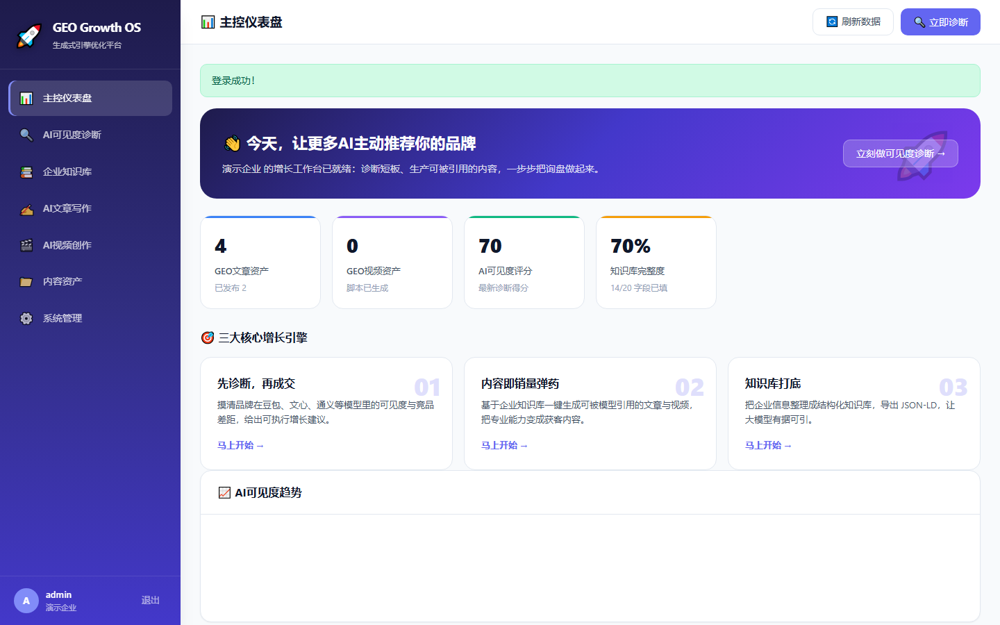
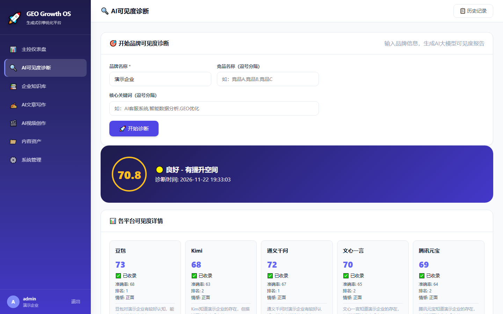
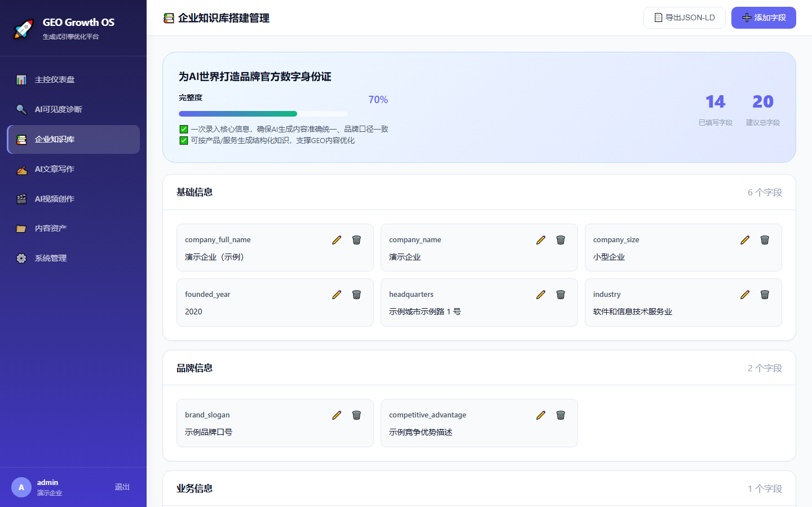
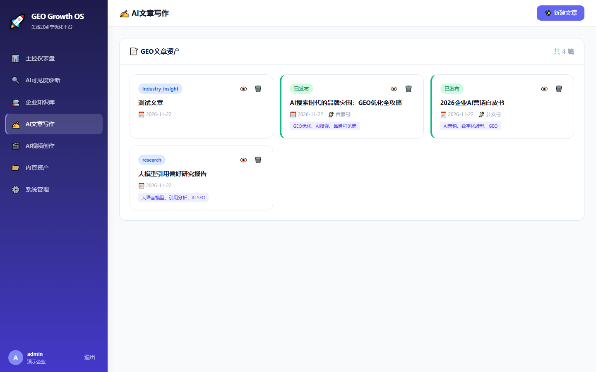

# GEO Growth OS

> 生成式引擎优化（GEO）工作台：诊断品牌在 AI 大模型里的可见度，建企业知识库，生成可被模型引用的内容。
> **零配置**——SQLite 免安装，不配大模型 API key 也能跑完整流程。


**仓库地址**（三端同步，代码一致）

- Gitee（主仓）：https://gitee.com/alongluodi/geo-growth-os
- GitCode：https://gitcode.com/alongluodi/geo-growth-os
- GitHub：https://github.com/alongluodi/geo-growth-os

<p align="center">
  
</p>

| 可见度诊断 | 企业知识库 | 内容生成 |
|:---:|:---:|:---:|
|  |  |  |

---

## 它解决什么问题

用户开始用豆包、Kimi、通义千问问"哪个牌子好"，而不是用百度搜索。

品牌在这类回答里出不出现，成了新的获客入口。GEO（Generative Engine Optimization）做的就是这件事：让 AI 在回答相关问题时，愿意引用你、推荐你。

这个工作台把 GEO 拆成一条能落地的动线：

```
诊断现状 → 补全知识库 → 生成可被引用的内容 → 沉淀为资产
```

**是**：单机的 GEO 工作台。Flask + SQLite，一个人一台电脑就能跑。

**不是**：不是多租户 SaaS。订单、客户管理、20+ 渠道自动分发、计费都在商业版里，不在这个仓库。

---

## 快速开始

只需 Python 3.9+，不需要装 MySQL，不需要配 API key。

```bash
pip install -r requirements.txt
python database.py      # 初始化 SQLite 库（幂等）
python app.py           # 打开 http://localhost:5000
```

浏览器打开后，用 `admin` / `admin123` 登录。

首次登录后建议立刻改密码（在「系统管理」页）。数据库文件默认在 `./data/geo.db`，删掉这个文件再跑 `python database.py` 就能恢复初始状态。

Docker 也可以：

```bash
docker build -t geo-growth-os .
docker run -p 5000:5000 -v $(pwd)/data:/app/data geo-growth-os
```

---

## 不配 API key 能跑到什么程度

这是这个仓库刻意保留的设计：**没有大模型 key，核心流程照样能演示**。

| 功能 | 无 key 行为 | 配 key 后 |
|---|---|---|
| AI 可见度诊断 | 基于知识库完整度做确定性估算，给出各平台评分与建议 | 调用大模型实测分析，返回真实诊断 |
| 文章生成 | 用内置模板按标题和关键词生成完整文章，带 GEO 评分 | 大模型按知识库定制生成 |
| 视频脚本 | 按 Hook→痛点→产品→卖点→背书→CTA 六段式生成 | 大模型按知识库定制生成 |
| 知识库 / JSON-LD | 完整可用 | 完整可用 |
| 数据看板 | 完整可用 | 完整可用 |

诊断报告里会明确标注数据来源是"确定性估算"，不会冒充实测——这点很重要，GEO 工具最忌讳假数据装真实。

想接自己的模型，在「系统管理」页填 OpenAI 兼容的 `api_base`、`api_key`、`model` 即可，支持豆包、通义、DeepSeek 等。

---

## 功能一览

| 模块 | 路由 | 做什么 |
|------|------|--------|
| 主控仪表盘 | `/dashboard` | 文章数、视频数、可见度评分、知识库完整度、趋势图 |
| AI 可见度诊断 | `/ai-diagnostic` | 输入品牌/竞品/关键词，出评分、各平台详情、优化建议、行动清单 |
| 企业知识库 | `/knowledge-base` | 分类管理企业信息，完整度可视化，一键导出 JSON-LD |
| AI 文章写作 | `/ai-writing` | 6 种文章类型，自动植入关键词，GEO评分 |
| AI 视频脚本 | `/ai-video` | 六段式脚本生成，按场景拆分 |
| 内容资产 | `/content-assets` | 已生成的文章/视频/引用截图统一沉淀 |
| 系统管理 | `/settings` | 模型配置、用户管理、站点名称 |

底部数据全在本地 SQLite，导出的 JSON-LD 可直接放到官网 `head` 里给大模型读。

---

## 技术栈

| 层 | 选型 | 说明 |
|----|------|------|
| 后端 | Python 3.9+ / Flask 3.0 | 单进程即可运行 |
| 数据库 | SQLite 3 | Python 标准库，零配置；通过兼容层保留 MySQL 风格 SQL |
| 前端 | Jinja2 + 原生 JS + Chart.js | 无构建步骤，改模板即生效 |
| 大模型 | OpenAI 兼容接口 | 可选，不配也能跑 |
| 部署 | 直接运行 / Docker / Gunicorn | — |

**一个实现细节**：上层代码沿用 MySQL 的 `%s` 占位符和 `NOW()` 写法（`database.py` 的 `_to_sqlite_sql()` 在运行时转换）。这样同一套业务代码既能跑 SQLite 也能接 MySQL，如果你想迁回 MySQL，只需改连接层。

---

## 目录结构

```
geo-growth-os/
├── app.py              # Flask 路由与权限
├── ai_service.py       # 诊断引擎、内容生成、知识库、看板
├── database.py         # SQLite 兼容层 + 建表 + 种子数据
├── templates/          # Jinja2 页面
├── static/             # CSS / JS
├── docs/screenshots/   # 真实运行截图
├── data/               # 运行时生成（.gitignore 已排除）
├── requirements.txt
└── Dockerfile
```

---

## 开源版 vs 商业版

| 能力 | 本仓库 | 完整系统 |
|------|:---:|:---:|
| AI 可见度诊断（含无 key 估算） | ✅ | ✅ |
| 企业知识库 + JSON-LD 导出 | ✅ | ✅ |
| 文章 / 视频脚本生成 | ✅ | ✅ |
| 内容资产库 + 数据看板 | ✅ | ✅ |
| 多平台分发调度（20+ 渠道） | — | ✅ |
| 客户 / 订单管理 | — | ✅ |
| 多租户 + 计费 + 权限套餐 | — | ✅ |
| 私有化部署支持 | — | ✅ |

需要完整方案可加微信 `softzero100`，或在 Issue 里提需求。

---

## 关于数据来源

无 key 模式的诊断结果是基于知识库完整度的**确定性估算**，不是平台实测。

它适合演示流程、验证集成、理解 GEO 的评分维度；要拿去做真实的品牌决策，请在系统管理里配置大模型 key，用实测模式。

项目内置的所有演示数据（公司名、地址、联系方式、文章）都是虚构的，不含任何真实客户信息。

---

## 路线图

- [ ] 诊断报告的 PDF 导出
- [ ] 知识库字段模板（按行业预置）
- [ ] 引用截图的自动采集
- [ ] 更多 GEO 评分维度

欢迎提 Issue 和 PR。

---

## English

**GEO Growth OS** — A self-hosted Generative Engine Optimization workbench.

Diagnose how visible your brand is in AI answers (Doubao, Kimi, Tongyi, etc.), build a structured knowledge base, and generate citable content.

- **Zero setup**: SQLite, no external database, no API key required
- **Honest data**: without an LLM key, diagnostics are labeled as deterministic estimates, not fake live results
- **MIT licensed**

```bash
pip install -r requirements.txt
python database.py
python app.py
```

Open `http://localhost:5000`, login with `admin` / `admin123`.

Video walkthrough: Douyin **阿龙做系统落地**. Deep tutorials: WeChat **soft零壹零**.

---

视频讲解 @抖音「阿龙做系统落地」 · 深度教程 @公众号「soft零壹零」

## License

MIT © 2026 alongluodi
